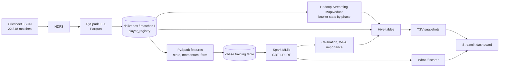

# Ball-by-Ball Win Probability

A distributed Big Data pipeline over the [Cricsheet](https://cricsheet.org) ball-by-ball dataset that estimates, **after every delivery of a run chase, the probability that the chasing team wins**. It also measures how much each ball moved that probability, computes bowler statistics by phase of the innings, and serves everything through a Streamlit dashboard.

Built with **HDFS, YARN, Hadoop Streaming MapReduce, Hive, PySpark / Spark MLlib and Streamlit**, running as a 10-container Docker Compose cluster on a single machine.

> Cricket matches can turn on one ball, yet common tools (Duckworth-Lewis-Stern, WASP) describe a match by little more than overs and wickets. This project uses the full match situation, recomputed ball by ball, and checks whether its percentages can be trusted.

## What it does

| Capability | Output |
|---|---|
| Ball-by-ball chase win probability | 2,565,140 scored deliveries across 17,711 chases |
| Win Probability Added (WPA) | How much each ball moved the odds; the biggest swings per match |
| Calibration | Isotonic correction so "70%" means about 70% |
| Model comparison | Gradient-Boosted Trees vs Logistic Regression vs Random Forest on identical held-out rows |
| Feature importance | Which feature groups the models rely on (permutation importance) |
| Bowler phase statistics | Economy, wickets and dot-ball % by powerplay / middle / death (MapReduce, 33,107 rows) |
| Batter vs bowler lookup | 1.17M head-to-head records with sample-size reliability tiers |
| What-if scorer | Win probability for any hypothetical chase state, by gender and level |

## Results

Chronological split: trained on seasons before 2021/22 (1,363,580 rows), tested on 2021/22 onward (1,201,560 rows the model never saw).

| Model | AUC | Brier | Log-Loss | ECE | Accuracy |
|---|---|---|---|---|---|
| Logistic Regression | 0.9140 | 0.1192 | 0.3698 | 0.0093 | 0.8262 |
| **Gradient-Boosted Trees (production)** | 0.9133 | 0.1201 | 0.3727 | 0.0164 | 0.8248 |
| Random Forest | 0.9054 | 0.1264 | 0.3974 | 0.0333 | 0.8186 |

The project's targets (AUC >= 0.82, Brier <= 0.18, Log-Loss <= 0.50) are met by all three models. Logistic Regression is marginally the best and wins 8 of 10 held-out seasons on Log-Loss, so the tree model is **not** claimed to be the best. Almost all of the predictive power comes from the chase situation itself (runs and rate needed against balls and wickets left).

Adding two context features (`is_female`, `is_international`) improved held-out Log-Loss by 0.0053 (match-level 95% interval [-0.0073, -0.0034]; 9 of 10 seasons better) and cut the over-optimism for women's matches by about 60%.

## Architecture



## Dashboard

Five views: **bowler economy by phase** (rank by economy or dot-ball %), **match explorer** (win-probability curve, WPA per ball, five biggest swings), **batter vs bowler**, **model scorecard** (model comparison, reliability chart, feature importance) and **what-if win probability**.

```bash
pip install -r dashboard/requirements-dashboard.txt
bash dashboard/export_snapshots.sh        # needs the cluster running
python -m streamlit run dashboard/app.py --server.port 8501
```

The dashboard reads Hive when PyHive is available and otherwise falls back to the exported TSV snapshots, saying which in the sidebar. The what-if view needs Docker, because it scores inside the Spark container.

## Repository layout

| Path | Contents |
|---|---|
| `hdfs_scripts/` | Create the HDFS layout, classify and upload raw files, verify the upload |
| `etl/` | `flatten_matches.py` (JSON to Parquet) and `schema_utils.py` (schemas and every HDFS path) |
| `mapreduce/` | Mapper, reducer and phase rules for bowler economy by phase; `verify_with_spark.py` independently checks the output |
| `hive/` | `01`-`10_*.hql` table definitions and `run_all.sh` |
| `features/` | Match-state, player-form, training-table, opponent, venue and matchup-lookup builders |
| `ml/` | Training, scoring, calibration, WPA, model comparison, feature importance, evaluation and verification scripts, what-if scorer |
| `dashboard/` | Streamlit app, data access layer, snapshot export |
| `docker/`, `docker-compose.yml`, `hadoop.env` | The 10-container cluster |
| `docs/` | Full project report, literature survey, viva cheat sheet, detailed run instructions (`RUNNING.md`) |
| `CLAUDE.md` | Working notes: verified numbers, bugs found, environment quirks, roadmap |

## Quick start

Full, tested commands are in [`docs/RUNNING.md`](docs/RUNNING.md). In outline (Docker Desktop and about 10 GB of RAM for the cluster are needed):

```bash
docker compose up -d --build
export MSYS_NO_PATHCONV=1        # Git Bash on Windows only
# 1. upload   2. flatten   3. MapReduce   4. Hive   5. features   6. train and score   7. calibrate, WPA, compare
```

The raw data is not in this repository (3.8 GB). Download the Cricsheet JSON files and place them in `data/raw/all_json/`.

## How it was verified

- **No leakage:** date-based split; rolling-form windows end before the current match; opponent and venue features checked against a brute-force recomputation.
- **Independent recomputation:** the MapReduce output matches a separate Spark computation on all 33,107 rows (zero mismatches).
- **Invariants:** WPA sums exactly to the final minus starting probability; the saved calibrator reproduces its stored values and matches an independent scikit-learn fit to 4 decimals.
- **Uncertainty:** confidence intervals resampled by match, and placebo controls for added features.
- **Reproducibility:** the cluster was torn down and rebuilt once with identical results.

There is no automated unit-test suite yet.

## Limitations

- The cluster has **one data node on one machine**: it demonstrates the architecture, not cluster speed-up or fault tolerance.
- The model is still over-optimistic by roughly 5-7 points for women's matches and about 4 points for men's internationals in the 45-85% band.
- Not built: sequence models (LSTM), XGBoost, SVM, Decision Tree or voting ensembles, and per-prediction explanations (global importance only).
- Opponent-form and venue features were built and evaluated but are not in the production model. Batter-vs-bowler data is too sparse to be a feature and is a lookup only.
- Bowler rankings are raw records with no adjustment for opposition strength.
- Historical, batch analysis only; there is no live data feed.
- The dashboard's Hive code path is untested (PyHive does not install on the development machine); the TSV fallback is what runs.

## Documentation

- [`docs/PROJECT_REPORT.md`](docs/PROJECT_REPORT.md) / [`Project_Report.docx`](docs/Project_Report.docx): full evidence-based report
- [`docs/Viva_Cheat_Sheet.pdf`](docs/Viva_Cheat_Sheet.pdf): one-page summary
- [`docs/literature_review.pdf`](docs/literature_review.pdf): literature survey
- [`CLAUDE.md`](CLAUDE.md): detailed progress notes and roadmap

## Data and licence

Match data comes from [Cricsheet](https://cricsheet.org); check its terms before reuse or redistribution. This repository does not yet include a licence file.

## Author

Vaibhav Kamboj
