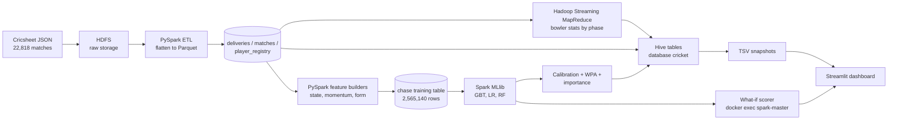
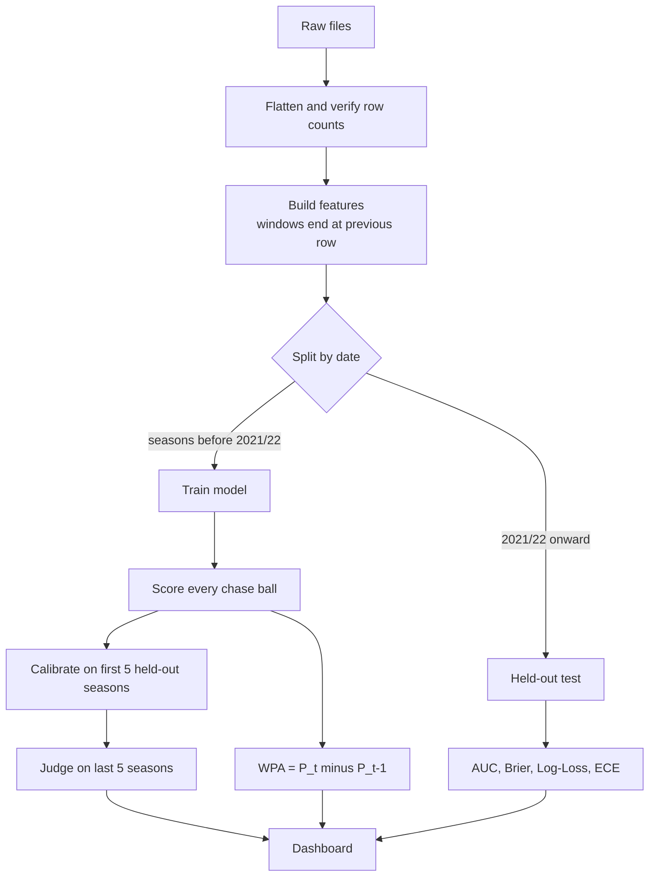

# Ball-by-Ball Win Probability: Complete Project Report

*A distributed Big Data pipeline over the Cricsheet ball-by-ball dataset (HDFS, Hadoop MapReduce, Hive, PySpark / Spark MLlib, Streamlit).*

**How to read this report.** Every statement is tagged by how well it is supported:

- **Verified** means it was measured or checked in this project and the evidence (script, table, log or file) is named.
- **Interpretation** means a reasonable reading of verified facts.
- **Assumption / Proposal** means it has not been demonstrated.

Team names, individual contributions, real timeline dates and any user feedback are **not** in the materials, so they are not stated. Section 12 lists everything still required.

---

## 1. Project overview and executive summary

**What was built.** A system that reads about 22,800 ball-by-ball cricket match files (about 11.5 million deliveries, 3.8 GB of JSON) from Cricsheet, stores them in a Hadoop cluster, and produces after every delivery of a run chase the estimated probability that the chasing team wins. It also computes how much each ball moved that probability, per-bowler statistics by phase of the innings, and a batter-versus-bowler lookup. The results are explored in a five-view Streamlit dashboard.

**Where it stands (all verified in this project):**

| Item | Result |
|---|---|
| Scale | 22,818 matches, 11,492,709 deliveries; 2,565,140 chase-ball rows across 17,711 chases used for the model |
| Test method | Chronological: train on seasons before 2021/22 (1,363,580 rows), test on 2021/22 onward (1,201,560 rows) |
| Best model on unseen seasons | Logistic Regression: AUC 0.9140, Brier 0.1192, Log-Loss 0.3698. The production Gradient-Boosted Trees model: AUC 0.9133, Brier 0.1201, Log-Loss 0.3727, accuracy 82.5% |
| Synopsis targets (AUC >= 0.82, Brier <= 0.18, Log-Loss <= 0.50) | All three met on held-out data |
| Cluster | 10-container Docker Compose cluster on one Windows laptop, rebuilt from scratch once and re-verified |
| Outputs | 10 Hive tables, a MapReduce job independently cross-checked, 5 dashboard views |

**What is honestly not done.** No LSTM or other sequence model; no XGBoost, SVM, Decision Tree or Voting ensemble (three models are compared: GBT, Logistic Regression, Random Forest); opponent-form and venue features were built and tested but are **not** in the production model; the batter-vs-bowler data is a lookup, not a model input; explanation is global (which feature groups matter) rather than per prediction; there is no live data feed, no automated unit-test suite, and no real-user evaluation. The cluster has a single data node, so it is a pseudo-distributed deployment, not a demonstration of cluster speed-up or fault tolerance.

**Overall readiness (my assessment, Section 10).** Strong, well-verified technical core and unusually honest evaluation; weaker on packaging (nothing committed since the second commit, no remote, outdated charter numbers), on documented testing, and on team/individual evidence.

---

## Chapter 1: Introduction

### 1.1 Title and overview
**Ball-by-Ball Win Probability** (repository `cricket-analytics-scaffold`). The project estimates, after every delivery of the second innings of a limited-overs match, the probability that the chasing team will win, using a large-scale data pipeline built on the Hadoop and Spark ecosystem.

### 1.2 Background and context
A cricket match can turn on one ball: a wicket, a six, or a run of dot balls (deliveries on which no run is scored). Common tools to judge a match mid-way describe it coarsely. The Duckworth-Lewis-Stern method reduces the state to overs remaining and wickets lost; WASP (Brooker and Hogan) uses historical state-transition probabilities (both from the project's literature survey, `docs/literature_review.pdf` and the synopsis). Neither knows who is batting or bowling, how the ground plays, or recent momentum.

### 1.3 Domain
Sports analytics, specifically limited-overs cricket (ODI, ODM, T20, IT20), implemented as a Big Data engineering and machine-learning project. (ODM = ODI matches played under a modified rules/over limit as coded in Cricsheet; IT20 = international T20.)

### 1.4 Why the topic matters
- Win probability turns a scoreboard into a story: it shows where a match actually turned.
- The raw material is large (millions of deliveries), so the problem is a genuine Big Data one rather than a spreadsheet one (synopsis, Problem Definition).
- The honest-probability question (does "70%" mean 70%?) is a real modelling problem and is measured here, not assumed.

### 1.5 Motivation and inspiration
The materials state the motivation as a combination of (a) available free ball-by-ball data and (b) the need to use industry-style distributed tooling. The synopsis frames it as doing "both things at once": build a proper large-scale data system and use it for a useful estimate. *Interpretation:* this is also an academic course project, so demonstrating the Big Data stack is itself a goal. Who inspired the choice of topic is not in the materials.

### 1.6 Intended audience
Evaluators and students (academic), and, as a prototype, analysts or broadcasters who want a ball-by-ball estimate. No actual users have been surveyed (see Section 12).

---

## Chapter 2: Problem Statement

### 2.1 The problem
There is no easily available, transparent, ball-by-ball win-probability estimate that is (1) driven by rich match context (run rates, momentum, player form, who is playing), (2) built on a reproducible large-scale pipeline, and (3) checked for whether its stated percentages can be trusted.

### 2.2 How it is handled now (from the literature survey)
| Existing approach | What it uses | Limitation recorded in the survey |
|---|---|---|
| Duckworth & Lewis (1998), later D/L/S | Overs remaining and wickets lost | Ignores batters, bowlers, venue, form, ball-by-ball patterns |
| WASP, Brooker & Hogan (2011-12) | Historical transition probabilities via dynamic programming | No distributed Big Data architecture, limited scale |
| Chakwate & Madhan (2020) | LSTM over ball-wise state | No distributed pipeline behind it, limited scale |
| Awan et al. (2021) | Spark MLlib to predict ODI team totals | Score prediction only; no win probability or full stack |
| Chakraborty et al. (2024) | Six classifiers, pre-match features | Pre-match only, no ball-by-ball updates |
| Wickramasinghe (2022) | Review of 72 cricket ML studies | Found in-match, ball-by-ball and infrastructure-scale work rare |

The literature survey itself notes that findings for rows 6, 7, 8 and 10 are summarised from the team's own reading and should be checked against the source papers before submission.

### 2.3 Difficulties for users
Analysts and fans cannot see how likely a win is at each moment, cannot see which ball mattered, and cannot tell whether a quoted percentage is reliable.

### 2.4 The gap addressed
Combining (a) a full HDFS + MapReduce + Hive + Spark pipeline, (b) in-match ball-by-ball probabilities, and (c) explicit calibration and importance analysis. The survey's own gap statement is that no reviewed work combines these.

### 2.5 Consequence of leaving it unsolved
Match narratives stay coarse and unverified; the data stays a pile of JSON files. *Interpretation only; no external evidence of harm is claimed.*

---

## Chapter 3: Objectives and Scope

### 3.1 Primary objective
Produce a ball-by-ball chase win probability whose quality is measured on matches the model never saw, using a distributed Big Data pipeline.

### 3.2 Secondary objectives (the synopsis's five goals) and status
| # | Synopsis goal | Status (verified) |
|---|---|---|
| 1 | Get the data in and organised (HDFS, tables) | Done: 22,818 matches loaded, flattened to Parquet |
| 2 | Process the data two ways (MapReduce and Hive) | Done: MapReduce bowler-economy job (11 columns, independently verified), 10 Hive tables |
| 3 | Describe every match moment in detail (momentum, phase, ground, matchups) | Partly: state, momentum, phase, player form in the model; venue and opponent features tested, not adopted; matchups as a lookup only |
| 4 | Try several prediction methods fairly | Partly: three models compared on identical rows; no sequence model, XGBoost, SVM, Decision Tree or ensemble |
| 5 | Make predictions trustworthy and explainable | Mostly: calibration and reliability analysis done, WPA done, global feature importance done; per-prediction explanation not done |

### 3.3 Functional requirements (derived from the synopsis and the code)
1. Ingest raw Cricsheet JSON into HDFS and flatten to tabular Parquet.
2. Compute bowler economy, wickets and dot-ball % per phase with MapReduce.
3. Expose results through Hive SQL tables.
4. Build match-state, momentum and rolling player-form features without using future information.
5. Train and compare models with a date-based split; report AUC, Brier, Log-Loss, ECE, accuracy, precision, recall, F1.
6. Calibrate probabilities; compute win probability added per ball.
7. Provide an interactive dashboard and a what-if scorer.

### 3.4 Non-functional requirements
- **Correctness / no leakage:** date-based split; history windows end at the previous row; brute-force verification of history features (project invariants, `CLAUDE.md` section 7).
- **Reproducibility:** whole cluster from one `docker compose up -d --build`; verified by tearing down and rebuilding once.
- **Verifiability:** row-count reconciliation at each stage rather than trusting exit codes.
- **Honesty of reporting:** negative findings kept.
- Performance targets other than model quality are **not** stated in the materials.

### 3.5 Boundaries
- Limited-overs only (ODI, ODM, T20, IT20). Test matches are stored and queryable but excluded from phase and model work.
- Second innings (chases) only, because a target must exist.
- Historical, batch analysis; no live feed.

### 3.6 Deliverables
Cluster definition, ETL and feature code, MapReduce job, Hive DDL, trained models and scored tables, dashboard, synopsis, literature survey, and this report.

### 3.7 What it can and cannot do today
**Can:** score every historical chase ball by ball; score any hypothetical state typed into the what-if view (it runs a Spark job inside the cluster); rank bowlers by phase; look up batter-bowler records; show model quality and importance.
**Cannot:** ingest a live match; explain a single prediction; predict the first innings or Test matches; handle super overs (excluded); be deployed beyond one laptop.

---

## Chapter 4: Proposed Solution

### 4.1 In simple language
Teach a computer, from past chases, how often teams in a given situation (runs needed, balls and wickets left, who is playing) went on to win. Then ask it the same question after every ball of any chase, and measure how far each ball moved the answer.

### 4.2 How it addresses the problem
It uses far more context than overs and wickets; it recalculates after every ball; it is tested only on later seasons than it was trained on; and it checks whether its percentages are honest.

### 4.3 User journey (implemented)
1. Open the dashboard. 2. Pick a match in the **Match explorer**: see the win-probability curve, score progression, win-probability-added bars and the five biggest swings. 3. Open **Model scorecard** to see how good the models are and what they rely on. 4. Use **Batter vs bowler** and **Bowler economy** for player insight. 5. Use **What-if** to type a hypothetical situation and get a probability.

### 4.4 Main features and purpose
| Feature | Purpose |
|---|---|
| Ball-by-ball chase win probability | Core deliverable |
| Win Probability Added (WPA) | Shows which ball moved the match |
| Calibration (isotonic) | Makes stated percentages honest |
| Three-model comparison | Tests whether a fancier model is needed |
| Feature importance | Shows what the model relies on |
| MapReduce bowler phase statistics | Satisfies the heavy-batch requirement; feeds analysis |
| Matchup lookup | Head-to-head history with reliability tiers |
| Dashboard | Makes all of it visible |

### 4.5 Differentiation
Relative to the surveyed work: full distributed stack plus ball-by-ball in-match probabilities plus explicit calibration and honest negative results. *Interpretation:* the differentiation is mainly the combination and the rigour of evaluation, not a new algorithm.

### 4.6 Implemented versus proposed
Implemented: everything in 4.3-4.4. Proposed, not built: sequence model (LSTM), XGBoost/LightGBM, TreeSHAP per-prediction explanation, adoption of opponent and venue features, a live feed.
---

## Chapter 5: What We Have Done

### 5.1 Summary of work completed
A seven-stage pipeline plus nine follow-on work items were built and verified on one machine. Each stage was checked by row-count reconciliation, not only by "the command exited cleanly" (several earlier failures exited with code 0 but wrote zero rows). The work is recorded in `CLAUDE.md` (sections 4 and 5) and `README.md`.

### 5.2 Software modules and responsibilities
| Folder | Responsibility |
|---|---|
| `hdfs_scripts/` | Create HDFS directories, classify and upload raw files (via a manifest), verify the upload |
| `etl/` | `flatten_matches.py` turns nested JSON into Parquet; `schema_utils.py` holds the schemas and every HDFS path constant |
| `mapreduce/` | `mapper.py`, `reducer.py`, `phase_utils.py`, `run_job.sh`; `verify_with_spark.py` is an independent check |
| `hive/` | `01`-`10_*.hql` table definitions, `run_all.sh` |
| `features/` | Match-state, player-form, training-table, opponent, venue and matchup-lookup builders |
| `ml/` | Training, scoring, calibration, WPA, model comparison, feature importance, evaluation and verification scripts, what-if scorer |
| `dashboard/` | `app.py` (five views), `data_access.py` (Hive-first with TSV fallback), `export_snapshots.sh` |
| `docker/`, `docker-compose.yml`, `hadoop.env` | The 10-container cluster |

### 5.3 Frontend and backend
- **Frontend:** a Streamlit app with five views (bowler economy by phase, match explorer, batter vs bowler, model scorecard, what-if). Charts use Altair. Every view was run headlessly with Streamlit's `AppTest` (no exceptions) and the main views were inspected in a browser.
- **Backend:** there is no separate web back end. The dashboard reads TSV snapshots exported from Hive (`export_snapshots.sh`); the what-if view shells out to `docker exec spark-master spark-submit ml/predict_live_state.py`.

### 5.4 Database design and data flow
Raw JSON, then Parquet (`deliveries`, `matches`, `player_registry`), then derived Parquet (`match_state`, `player_form`, training table), then model outputs (`win_probability_by_ball`, `wpa_by_ball`, `win_probability_calibrated`, `model_comparison`, `feature_importance`, `matchup_lookup`), all exposed as Hive external tables in database `cricket`. MapReduce output is plain tab-separated text exposed as `bowler_economy_by_phase`.

Verified sizes: `deliveries` 11,492,709 rows x 35 columns; `matches` 22,818 x 26; `player_registry` 594,171 x 3; `match_state` 5,986,260; `player_form` 407,937; training table 2,565,140.

### 5.5 Algorithms and models
- **Gradient-Boosted Trees** (Spark `GBTClassifier`, 60 iterations, depth 5, seed 42): the production model.
- **Logistic Regression** and **Random Forest** (100 trees, depth 8): comparison models.
- **Isotonic regression** (and Platt scaling for comparison) for calibration.
- **Features:** 10 state features (score, wickets, balls remaining, run rates, runs required, required rate, rate difference, resources left, runs per wicket needed); 4 recent-momentum features (runs and wickets in the last 12 and 30 balls); 4 rolling player-form features (striker strike rate and average, non-striker strike rate, bowler economy over the previous matches); match type; and, since step 6b, `is_female` and `is_international`.
- No external APIs or paid services are used.

### 5.6 Security, validation, testing, error handling
- **Security:** none implemented. The dashboard has no login and the Hive connection uses no authentication (`auth="NONE"` in `data_access.py`). Acceptable for a local prototype, not for deployment.
- **Validation:** extensive data and result validation (Chapter 10).
- **Error handling:** the dashboard falls back from Hive to TSV snapshots and says so in the sidebar; what-if falls back from the cluster to local Spark; the Spark job fails loudly on null features (`handleInvalid="error"`).

### 5.7 Actual outputs produced
Scored table of 2,565,140 balls over 17,711 chases; WPA for every ball; 33,107 bowler-phase rows; 1,168,224 batter-bowler pairs (290,684 shown in the dashboard); model comparison (3 rows); feature importance (107 rows).

### 5.8 Feature-by-feature status table
Statuses: Completed, Partially Completed, Planned, Blocked. A feature is "Completed" only where a check or output is named.

| Component or feature | Purpose | Implementation details | Current status | Evidence |
|---|---|---|---|---|
| Docker cluster | Reproducible Hadoop/Spark/Hive environment | 10 containers: namenode, datanode, resourcemanager, nodemanager, historyserver, spark-master, spark-worker, hive-server, hive-metastore, metastore PostgreSQL | Completed (single data node, so pseudo-distributed) | `docker-compose.yml`; `docker ps` showed all 10 running; cluster torn down and rebuilt once and re-verified (`CLAUDE.md` s5) |
| HDFS ingest | Store raw data | Manifest-driven upload, 22,818 JSON files | Completed | `hdfs_scripts/`; HDFS holds 22,818 matches (19,703 limited-overs, 3,115 Test) |
| ETL flatten | Nested JSON to tables | PySpark `flatten_matches.py` to Parquet | Completed | Row counts above (`CLAUDE.md` s4) |
| MapReduce bowler phase job | Heavy batch statistics | Hadoop Streaming mapper/reducer; 11 output columns incl. dot balls | Completed and independently verified | `mapreduce/`; 33,107 rows; zero mismatches against a Spark recomputation (`verify_with_spark.py`); original 9 columns byte-identical to pre-change output |
| Hive warehouse | SQL access | 10 external tables | Completed | `hive/*.hql`; row counts re-checked through Hive after the last re-run |
| Match-state and momentum features | Describe each ball's situation | `match_state_features.py` | Completed | 5,986,260 rows |
| Player-form features | Recent form without leakage | Rolling window over the previous 10 matches, ending one row before the current match | Completed (leakage guard by design; brute-force check was applied to opponent/venue features, not recorded for player form) | `player_form_features.py`, 407,937 rows |
| Training table | Chase rows with labels | Second innings, target defined, super overs excluded | Completed | 2,565,140 rows, label balance 50.8/49.2 |
| GBT training and scoring | Production probability | Chronological split; model saved to HDFS | Completed | AUC 0.9133, Brier 0.1201, Log-Loss 0.3727 on 1,201,560 held-out rows |
| Calibration | Honest probabilities | Isotonic fit on first 5 held-out seasons, judged on last 5; output clipped to [0.005, 0.995] | Completed, with a caveat | Independent scikit-learn check matched to 4 decimals; saved model reloads and reproduces values exactly. Evaluation Log-Loss 0.3718 to 0.3682, ECE 0.0188 to 0.0108; ECE after step 6b is slightly worse than before 6b (0.0069) |
| Win Probability Added | Show which ball mattered | P(t) minus P(t-1) from the chaser's view | Completed | 2,565,140 rows, 17,711 null (one per chase), 0 duplicates, telescoping error 0.0 |
| Model comparison | Test whether a complex model is needed | GBT, Logistic Regression, Random Forest on identical rows | Completed (3 models) | `model_comparison` table; GBT reproduces to 1.3e-7 AUC |
| Feature importance | Explain what the model uses | Native importances plus group permutation importance | Completed (global only) | `feature_importance` table, 107 rows |
| Gender/level context features | Fix missing context | `is_female`, `is_international` in the production model | Completed | Paired Log-Loss change -0.0053, 95% interval [-0.0073, -0.0034], 9 of 10 seasons improved (`ml/verify_context_adoption.py`) |
| Opponent-form features | Team head-to-head and form | Built and leakage-checked against brute force | Partially Completed (evaluated, not in production) | Small real gain concentrated early in the chase (`ml/evaluate_opponent_features.py`) |
| Venue par features | Ground history | Built, placebo-tested, gender/level controlled | Partially Completed (evaluated, not in production) | Small gain beyond gender/level (`ml/evaluate_venue_features.py`) |
| Batter-vs-bowler lookup | Head-to-head records | 1,168,224 pairs with tiers, expected strike rate, z-score | Completed as a lookup; deliberately **not** a model feature | `features/matchup_lookup.py`; most pairs are tiny samples (877,540 pairs under 12 balls) |
| Dashboard | Make results visible | 5 views, TSV-snapshot fallback | Completed; Hive path untested | `AppTest` no exceptions in all views; browser inspection; row counts of every snapshot match Hive |
| What-if scorer | Score a hypothetical state | Runs Spark inside the container | Completed | Same chase state: 0.346 men's international vs 0.234 women's international |
| LSTM / sequence model | Per synopsis | Not built | Planned | Roadmap item 11 in `CLAUDE.md` |
| XGBoost / LightGBM, SVM, Decision Tree, Voting ensemble | Per literature gap | Not built | Planned | Roadmap item 10; `CLAUDE.md` s9 |
| TreeSHAP per-prediction explanation | Per synopsis step 6 | Not built | Planned | Roadmap item 12 |
| Live match feed | Real-time use | Not in scope of materials | Planned (proposal only) | None |
| Automated unit-test suite | Regression safety | No test directory in the repo | Planned | Repository listing |
| Version control | Traceability | Two commits only; later work uncommitted; no remote | Partially Completed | `git log`: `693361f`, `1ba3683` |

---

## Chapter 6: How the Project Works

### 6.1 Step by step
1. **Start.** Start Docker, then the cluster (`docker compose up -d --build`). The pipeline stages are run in order (README); the dashboard needs only the exported snapshots, plus Docker for the what-if view.
2. **Input.** Cricsheet JSON files: one per match, nested, with innings, overs, deliveries, runs, extras and wickets.
3. **Process.**
   - Stage 1 uploads files to HDFS and classifies them by format.
   - Stage 2 flattens each match into one row per delivery (Parquet).
   - Stage 3 runs MapReduce for bowler economy by phase, and Hive exposes the tables.
   - Stage 4 builds match-state, momentum and player-form features.
   - Stage 5 joins them into a chase-only training table.
   - Stage 6 trains the model on older seasons and scores every chase ball.
   - Stage 7 calibrates, computes WPA, compares models and measures feature importance.
4. **Modules.** Spark (PySpark, MLlib) for features and models; Hadoop MapReduce for bowler statistics; Hive for SQL access.
5. **Information flow.** Each stage's output is the next stage's input, stored on HDFS.
6. **Output.** Probability per ball, WPA per ball, tables, charts and numbers in the dashboard.
7. **Benefit.** A viewer sees where a match turned and how trustworthy the numbers are.

### 6.2 System architecture (Mermaid)

### 6.3 Workflow (Mermaid)

### 6.4 Key concepts, in plain and technical language
| Concept | Plain language | Technical |
|---|---|---|
| HDFS | A big shared hard drive spread over machines | Distributed file system with block replication; NameNode keeps metadata, DataNodes hold blocks |
| MapReduce | Split a counting job into many small piles, then add the piles | Map emits key-value pairs, framework sorts by key, reduce aggregates per key; here via Hadoop Streaming with Python |
| Hive | Ask questions in SQL | SQL layer over files in HDFS; schema-on-read external tables |
| Spark | A faster way to run big calculations in memory | Distributed DataFrame engine; MLlib supplies models |
| Chronological split | Train on the past, test on the future | Prevents leakage of same-match or future information |
| Calibration | Make "70%" mean 70% | Isotonic regression maps raw scores to observed frequencies |
| Brier / Log-Loss | Penalties for wrong or overconfident percentages | Mean squared error and negative log-likelihood of the predicted probability |
| ECE | Average gap between predicted and actual | Expected calibration error over 10 probability buckets |
| WPA | How much one ball changed the odds | Difference of consecutive win probabilities |

---

## Chapter 7: Technology Stack

| Technology | Role | Why selected | Where used | Actual use verified? |
|---|---|---|---|---|
| Docker and Docker Compose | Run a multi-service cluster on one laptop | Reproducible; native Hadoop/Spark on Windows is painful (`CLAUDE.md` s1) | `docker-compose.yml`, `docker/` | Yes (10 containers running; rebuild test) |
| HDFS (Hadoop 3.2.1) | Distributed storage | Course objective; holds 3.8 GB of raw JSON | `hdfs_scripts/` | Yes (22,818 matches stored) |
| YARN | Resource management | Part of Hadoop; runs the MapReduce job | `hadoop.env`, `mapreduce/run_job.sh` | Yes (job ran; two YARN config bugs fixed) |
| Hadoop Streaming MapReduce | Bowler economy by phase | Required "heavy batch" style; simple key-aggregation | `mapreduce/` | Yes, cross-checked in Spark |
| Apache Hive 2.3.2 | SQL access to results | Required "ad-hoc query" layer | `hive/` | Yes (10 tables counted through Hive) |
| PostgreSQL | Hive metastore backend | Required by the Hive image | `hive-metastore-postgresql` container | Yes (running) |
| Apache Spark 3.1.1 / PySpark | ETL, features, modelling | In-memory, handles joins and windows at scale | `etl/`, `features/`, `ml/` | Yes |
| Spark MLlib | GBT, Logistic Regression, Random Forest, isotonic | Trains inside the cluster on the full data | `ml/` | Yes |
| Parquet | Columnar storage for derived tables | Compact and fast for Spark | `/data/processed/*` | Yes |
| Python (3.7 in spark-master, 3.5 in namenode, 3.14 on host) | All scripts | Spark/Hadoop Streaming language of choice | Everywhere | Yes |
| Streamlit, Altair, pandas | Dashboard | Quick interactive Python UI | `dashboard/` | Yes (AppTest and browser) |
| beeline | Run Hive scripts, export snapshots | Ships with the Hive image | `hive/run_all.sh`, `export_snapshots.sh` | Yes |
| python-docx | Build the Word documents | No Word on the host | Document generators outside the repo | Yes |
| PyHive | Hive connection from the dashboard | Planned primary path | `data_access.py` | **No**: not installed (needs a C toolchain on Windows); SQL path is untested; TSV fallback is what runs |
| mlflow | Experiment tracking | Optional | `train_win_probability.py` | **No**: not installed in the container; the script skips it |
| Delta Lake | Listed in an earlier plan | Little benefit for immutable data | None | Not used (recommended to drop) |
| XGBoost, LightGBM, TensorFlow/PyTorch | Proposed models | Literature gap | None | Not used |

---

## Chapter 8: Why We Built This Project

### 8.1 Why this problem
Ball-by-ball data is free and large; win probability is a well-defined, measurable target; and the gap in the survey (no distributed, in-match, calibrated approach) gives an academically defensible contribution. *Interpretation:* topic choice was also shaped by the course's Big Data requirements.

### 8.2 Why each major design decision
| Decision | Reason | Evidence |
|---|---|---|
| Split by date, not randomly | A random split puts balls of one match on both sides and inflates scores | Synopsis; `chronological_split` |
| Chase (second innings) only | A target must exist to define "win" | Training table rule |
| MapReduce for bowler stats, Spark for the rest | Course requires both; MapReduce suits one-pass aggregation; Spark suits iterative ML | Synopsis goal 2; Spark recomputation shows both agree |
| Docker | One-command reproducible cluster | `CLAUDE.md` s1 |
| Compare several models | To test, not assume, that a complex model helps | Result: Logistic Regression matches or beats GBT |
| Calibrate and measure reliability | Accuracy alone does not make a probability trustworthy | Calibration gaps measured per segment |
| Rolling form ends one row before the match | Avoids leakage | `rowsBetween(-10,-1)` |
| Matchups as a lookup, not a feature | Too sparse; also summarises the whole dataset so it would leak | `matchup_lookup.py` docstring |
| Keep negative results (opponent, venue, matchups, era-shift correction) | Honest evaluation | `CLAUDE.md` s4-5 |
| Report with confidence intervals and a placebo | To tell real gains from noise | Evaluation scripts |

### 8.3 Verified benefits
- A measured, reproducible win probability that meets all three synopsis targets on unseen seasons.
- A verified finding that the model lacked gender and level context, fixed in step 6b (Log-Loss -0.0053; women's calibration gap cut by roughly 60%).
- A finding that a simple Logistic Regression is as good as the tree model, which saves complexity.
- Independent verification of the MapReduce results (zero mismatches).

### 8.4 Expected or hypothetical benefits (not demonstrated)
Time or cost savings for analysts, usefulness to broadcasters, better coaching decisions, and any commercial value. No user study or trial exists.

### 8.5 Skills demonstrated by the team
Distributed storage and processing, SQL warehousing, feature engineering with leakage control, model evaluation (calibration, confidence intervals, placebo controls), containerised infrastructure, data-visualisation, and technical documentation. *Individual attribution is unknown (Section 12).*
---

## Chapter 9: Business Analysis and Commercial Potential

**Status of this chapter.** The project materials contain no market research, pricing, customer data or financial plan. Everything below is a structured set of **hypotheses**, not findings. No market size, revenue or cost figure is given because none exists in the evidence. What has actually been built is a technical prototype, not a product.

### 9.1 Possible user segments (hypotheses)
| Segment | Possible need | Fit with current build |
|---|---|---|
| Broadcasters and sports media | On-screen win probability and "turning point" graphics | Concept fit; no live feed, no API |
| Fantasy and analytics platforms | Ball-level probabilities and player insights | Partial (historical only) |
| Team analysts and coaches | Post-match review of which ball mattered; matchup records | Partial (lookup is sparse, no opposition-quality adjustment) |
| Fans, writers, educators | Explanations and visual stories | Dashboard works as a demo |
| Students and researchers | A reproducible Big Data reference project | Strong fit (reproducible cluster, documented evaluation) |

### 9.2 Customer pain points
Coarse match-state tools (survey: DLS, WASP); no way to see which ball mattered; probabilities that are rarely checked for honesty.

### 9.3 Value proposition
A ball-by-ball probability that is evaluated on future seasons, honest about its limits, and reproducible. *The measured quality is the verified part; commercial value is unproven.*

### 9.4 Alternatives and competitors
The survey names DLS and WASP. Other commercial win-probability products exist in practice, but none are described in the materials. **Missing:** a competitor scan with sources.

### 9.5 Differentiation (honest)
Open, reproducible, calibrated and transparent about weaknesses. It does **not** currently outperform any named competitor: no head-to-head comparison with WASP, DLS or a commercial tool was made.

### 9.6 Business model options (all hypothetical)
Licensing or API access to probability feeds; a subscription analytics dashboard; sponsored content or media partnerships; consulting and training around the pipeline; an educational reference implementation.

### 9.7 Cost structure (qualitative)
Compute and storage for the cluster, a live ball-by-ball data source (licensing terms and cost unknown), engineering and maintenance time, model retraining and monitoring. **Missing:** all figures. **Check:** the licence terms of the Cricsheet data before any commercial use.

### 9.8 Operational requirements for a product
Live ingestion, an API service, authentication, monitoring, scheduled retraining, separate calibration for women's, club and associate cricket, and uptime guarantees. None exist today.

### 9.9 Acquisition and distribution
Not in the materials. Plausible channels: academic publication, open-source release, demos to cricket-media contacts. All unvalidated.

### 9.10 Scalability
Spark and HDFS scale horizontally in principle, but this was **not demonstrated**: the cluster has one data node on one laptop. Training times recorded here (GBT 73 s, Logistic Regression 19 s, Random Forest 55 s on 1.36M rows) say nothing about larger clusters.

### 9.11 Risks and barriers
- Model still over-optimistic for women's matches (about +5 to +7 points in the 45-85% band after step 6b) and by about 4 points for men's internationals.
- Trust: users must believe percentages; honest calibration helps but is not proven in use.
- Data licensing and live-data cost unknown.
- Competition from established broadcast tools.
- No security or multi-user capability.

### 9.12 Future commercial opportunities
Per-prediction explanations (TreeSHAP) for broadcasters; a first-innings and pre-match model; team-specific tools; an educational product. All proposals.

### 9.13 Implemented vs possible
**Implemented:** research-grade prototype and dashboard. **Possible:** everything in 9.6-9.12.

---

## Chapter 10: Testing and Validation

**Important:** the repository has **no automated unit-test suite** and no continuous integration. The validation below consists of verification scripts, reconciliation checks and manual inspection performed during development; they are real evidence, but they are not a formal test plan.

### 10.1 Strategy
Verify every stage by counts and invariants; recompute important results independently in a different engine; guard against leakage; quantify uncertainty with match-level confidence intervals; test changes against a saved backup.

### 10.2 Executed checks and results
| # | Check | Expected | Actual | Evidence |
|---|---|---|---|---|
| 1 | Upload completeness | All raw files in HDFS | 22,818 matches (19,703 limited-overs, 3,115 Test) | `hdfs_scripts/02_verify_upload.sh`, `CLAUDE.md` s4 |
| 2 | Flatten row reconciliation | Row counts consistent through stages | 11,492,709 deliveries; 5,986,260 match-state rows; 2,565,140 training rows | `CLAUDE.md` s4 |
| 3 | MapReduce vs independent Spark recomputation | Identical per (bowler, format, phase) | 33,107 rows, zero mismatches on runs, balls, wickets, dots and derived columns | `mapreduce/verify_with_spark.py` |
| 4 | MapReduce regression after adding dot balls | Old columns unchanged | Original 9 columns byte-identical (matching checksums) | Backup `/data/mapreduce_backup/economy_before_dots` |
| 5 | WPA invariants | One null per chase; no duplicate keys; per-chase WPA sums to last minus first probability | 17,711 nulls = 17,711 chases; 0 duplicates; telescoping error 0.0 | `ml/compute_wpa.py` output |
| 6 | Calibration cross-check | Own isotonic equals an independent fit | Identical to 4 decimals vs scikit-learn; saved model reloads and reproduces every value | `CLAUDE.md` s5 |
| 7 | Calibration output bounds | Within [0.005, 0.995] | 0 values outside | `calibrate_win_probability.py` output |
| 8 | Model reproducibility | Retrain reproduces saved run | AUC difference 1.3e-7 | `compare_models.py` output |
| 9 | History features vs brute force | No leakage | Verified against a self-join on strictly earlier matches; found and excluded one duplicated key from same-name players | `opponent_features.py`, `venue_features.py` |
| 10 | Placebo control | Shuffled venue data should give no gain | Used in the venue evaluation | `evaluate_venue_features.py` |
| 11 | Cluster rebuild | Rebuild gives same results | Down and up, stage 3 and scoring re-run clean | `CLAUDE.md` s5 |
| 12 | Step 6b before/after | Same rows, real gain | Identical 2,565,140 keys and split labels; Log-Loss -0.00533, 95% interval [-0.00729, -0.00336], 9 of 10 seasons better | `ml/verify_context_adoption.py` |
| 13 | Dashboard views | No exceptions | All 5 views and multiple input combinations ran with no exception; main views inspected in a browser | Streamlit `AppTest` session |
| 14 | Snapshot integrity | Exports equal Hive | All 8 snapshot row counts matched Hive exactly | `dashboard/export_snapshots.sh` run |
| 15 | What-if sensitivity | Context should change the answer | 0.346 (men's intl) vs 0.234 (women's intl) for the same state | Dashboard container path |

### 10.3 Results that went against expectations (kept on record)
- The first "baseline differs" in the opponent evaluation turned out to be Spark GBT row-order noise (about 1e-4); the tolerance was set to 5e-4 and the identical recipe was shown to reproduce exactly.
- After step 6b the calibrator's evaluation ECE rose from 0.0069 to 0.0108 (Log-Loss still improved); not yet investigated.
- Early claims that were corrected: calibration must be fitted out of sample; the "era shift" explanation was wrong (the cause was missing gender/level context); some quoted "unseen data" metrics had been computed on all rows.
- Eight infrastructure bugs were found and fixed (YARN aux-services, NodeManager memory, option ordering, PYTHONPATH, script newline, MSCK ordering, beeline CSV quoting, momentum imputation); a dashboard chart-sorting bug and a misleading economy ranking were also found and addressed.

### 10.4 Known limitations
Over-optimism remains for women's matches and men's internationals; phase boundaries for rain-shortened matches are approximate; isotonic output is a step function with only a few hundred distinct levels, so calibrated win probability added has flat stretches of exactly 0; bowler rankings are not adjusted for opposition quality; bowlers appear by id in the economy view.

### 10.5 Missing tests to do before final submission
1. A small automated test suite (phase boundaries, dot-ball rule, economy arithmetic, feature-window leakage) run on a tiny fixture.
2. A fresh-clone reproduction by someone other than the author.
3. The dashboard's Hive code path (currently untested).
4. Edge-case matches (rain-affected, abandoned, super over) examined explicitly.
5. A performance record for each stage (only some timings are noted).
6. A short usability check with two or three real users.
7. An out-of-sample test of whether earlier batter-bowler results predict later meetings.

---

## Chapter 11: Results and Achievements

### 11.1 Deliverables
Working 10-container cluster; ETL, features and models; MapReduce job; 10 Hive tables; five-view dashboard; synopsis, literature survey and this report.

### 11.2 Measured outcomes (held-out seasons 2021/22 onward, 1,201,560 rows)
| Model | AUC | Brier | Log-Loss | ECE | Accuracy |
|---|---|---|---|---|---|
| Logistic Regression | 0.9140 | 0.1192 | 0.3698 | 0.0093 | 0.8262 |
| Gradient-Boosted Trees (production) | 0.9133 | 0.1201 | 0.3727 | 0.0164 | 0.8248 |
| Random Forest | 0.9054 | 0.1264 | 0.3974 | 0.0333 | 0.8186 |

Targets: AUC >= 0.82, Brier <= 0.18, Log-Loss <= 0.50. **Met by all three models.** Logistic Regression wins 8 of 10 held-out seasons on Log-Loss, so "GBT is the best model" must **not** be claimed.

### 11.3 What drives the prediction (permutation importance, rise in Log-Loss when scrambled)
| Group | GBT | Logistic Regression |
|---|---|---|
| Chase pressure (runs required, required rate, rate difference, runs per wicket) | +0.749 | +1.091 |
| Overs and wickets in hand | +0.021 | +0.107 |
| Player form | +0.019 | +0.017 |
| Who is playing (gender, level) | +0.017 | +0.024 |
| Scoreboard | +0.007 | +0.029 |
| Match format | +0.002 | +0.003 |
| Recent momentum | +0.002 | +0.002 |

*Interpretation:* almost everything is the chase situation itself. Player form is modest; momentum (a headline feature in the synopsis) adds almost nothing once the state is known.

### 11.4 Other findings
- League-wide dot-ball rate 47.54% (2,744,127 of 5,771,895 legal balls); ODI powerplay 68.1%, middle 54.0%, death 40.7%; T20 50.8%, 37.2%, 34.0%.
- Raw 45-85% calibration gap (predicted minus actual) before to after context features: women's club +14.1 to +5.2 points, women's international +16.7 to +6.7, men's club -2.1 to -0.3, men's international +3.8 to +3.7.
- Opponent-form features: small real gain early in the chase, not adopted. Venue features: small gain beyond gender/level, not adopted. Batter-bowler matchups: too sparse to predict; kept as a lookup.

### 11.5 Original objectives vs current state
| Objective | Met? |
|---|---|
| Data in and organised | Yes |
| Two processing styles | Yes |
| Rich match description | Partly (venue, opponent, matchups not in production) |
| Several models, fairly compared | Partly (3 of the 6+ named in the survey; no sequence model) |
| Trustworthy and explainable | Mostly (calibration, WPA, global importance; no per-prediction explanation) |
| AUC, Brier, Log-Loss targets | Yes |

---

## Chapter 12: Challenges and Limitations

| Challenge / limitation | Detail | Practical remedy |
|---|---|---|
| Environment | Windows host, old container images (Spark 3.1.1, Python 3.5/3.7), path mangling by Git Bash, stopped Docker Desktop | Documented in `CLAUDE.md` s8; `MSYS_NO_PATHCONV=1`; startup check |
| Slow small-file work | Stage 1 upload about 42 minutes through bind mounts | One-off; manifest-driven script |
| Silent failures | Several steps exited 0 with empty output | Row-count verification at every stage |
| Data limits | Mixed men's, women's, associate and club cricket; women's share doubled in recent seasons | Context features (done); separate calibration per segment (proposed) |
| Sparse matchups | 877,540 of 1,168,224 pairs under 12 balls | Lookup with tiers only |
| Not truly distributed | One data node, one laptop | State honestly; demonstrate on a multi-node cluster if scale claims are needed |
| Resource limits | 10 GB / 6 CPU for the cluster | Driver memory tuned (6 GB) |
| Incomplete business planning | No market or cost data | Chapter 9 gaps list |
| Missing validation | No unit tests, no users, no Hive-path test | Chapter 10.5 |
| Source control | Work since commit `1ba3683` uncommitted, no remote | Commit and push |
| Documents out of date | First charter and published artifact quote earlier Brier/Log-Loss and the discarded "era shift" explanation | Regenerate with current numbers |

---

## Chapter 13: Future Scope

**Essential before submission**
| Item | Purpose | Benefit | Priority | Needs |
|---|---|---|---|---|
| Commit all work; add a remote | Protect and evidence the work | Traceable history | Highest | Delete `*.bak*` and `verify_*.txt`; GitHub/GitLab account |
| Refresh the charter and artifact with current numbers | Remove incorrect claims | Consistency with evidence | High | Re-run document generators |
| Fill the team responsibility matrix | Show individual contribution | Needed for individual-understanding grading | High | Team input |
| Record the demo video | Evidence for evaluators | Safe fallback | High | Chapter "Demonstration plan" |
| Align the synopsis wording with what exists | State sequence models and per-prediction explanation as future work | Avoids over-claiming | High | Short edit |

**Short-term**
| Item | Purpose | Benefit | Needs |
|---|---|---|---|
| Small automated test suite | Regression safety | Credibility | A tiny fixture and pytest |
| Bowler names in the economy view | Usability | Clearer demo | Join with the player registry |
| Retest opponent features with context in baseline | Decide adoption | Possible early-chase gain | One evaluation run |
| Investigate the calibrator ECE rise | Understand a regression | Better calibrated output | Analysis of per-bucket gaps |
| Validated tuning of GBT | Fair comparison | Possibly closes the gap to LR | Validation on late training seasons only |

**Medium-term**
XGBoost/LightGBM (JAR compatibility risk on Spark 3.1.1); per-gender or per-segment calibration; matchup out-of-sample test; first-innings projection.

**Long-term / product**
TreeSHAP per-prediction explanations; LSTM sequence model (needs TensorFlow/PyTorch and per-match sequences); a live data feed and an API; authentication; a multi-node deployment.

---

## Chapter 14: Conclusion

**Problem.** Mid-match tools describe cricket coarsely, and the large ball-by-ball record is hard to exploit without distributed tools.

**Solution.** A Hadoop/Spark/Hive pipeline that produces a ball-by-ball chase win probability, tested on seasons it never saw, with calibration, win-probability-added and a dashboard.

**Accomplished.** The pipeline is built and verified; the model meets all three synopsis targets (AUC 0.913, Brier 0.120, Log-Loss 0.373 for the production model); a missing-context weakness was found and fixed with a measured gain; negative results were reported rather than hidden.

**Why it matters.** It shows a complete, reproducible Big Data workflow with unusually careful evaluation.

**Limitations.** Single-node cluster; remaining calibration bias for women's matches and men's internationals; no sequence model, XGBoost or per-prediction explanation; no live feed; no formal tests or user evaluation; packaging not finished.

**Remaining.** Version control, document refresh, tests, team evidence, demo recording.

**Potential.** A credible academic prototype. Commercial potential is plausible but unvalidated.

---

# Technical architecture and workflow diagrams

Both diagrams are in Chapter 6 (Mermaid source) and are also drawn as images in the Word version.

---

# Demonstration plan (3-5 minutes)

**Do not demonstrate anything outside this list.**

### Script
| Time | Screen | Action | Expected output | Evidence it proves |
|---|---|---|---|---|
| 0:00-0:30 | Slide or README | State the problem and the headline numbers | - | Problem and scale (22,818 matches, 11.5M deliveries) |
| 0:30-1:00 | HDFS UI (`localhost:9870`) or `docker ps` | Show 10 containers running and `/data/processed` | Containers up; datasets present | Real cluster |
| 1:00-2:00 | Dashboard, **Match explorer** | Choose a match; scroll through curve, score, WPA bars, five biggest swings | Curve moves with wickets and boundaries; swings table names batter and bowler | Ball-by-ball probability and WPA |
| 2:00-2:45 | **Model scorecard** | Show the comparison table, the reliability chart, the importance bars | Three models; points near the diagonal; chase pressure dominates | Fair testing, calibration, explanation |
| 2:45-3:30 | **What-if** | T20, target 180, score 120, wickets 4, balls remaining 36; press Estimate for men's international, then women's international | About 34.6% then about 23.4% | Model responds to context (needs Docker; about a minute per call) |
| 3:30-4:15 | **Batter vs bowler** (V Kohli, T20) and **Bowler economy** (Dot-ball %) | Show tiers and the warning banner | Table with tiers; banner on raw rankings | Player insight, honesty about limits |
| 4:15-5:00 | Slide | Limitations and next steps | - | Honest disclosure |

### Suggested narration (short)
"Cricket matches turn on single balls, but common tools only look at overs and wickets. We built a Hadoop and Spark pipeline over 22,818 matches that gives the chasing team's win probability after every ball. We tested only on later seasons than we trained on, so the numbers are honest, and all three of our targets are met. Here is a chase: the curve moves with each wicket, and we can see the five balls that swung it most. Here is how the models compare; a simple logistic regression is as good as the tree model. And the percentages are checked: when we say 70 percent, the team wins about 70 percent of the time. Here is what-if: the same situation gives a lower chance in women's cricket, because the model learned that context. Finally, our limitations: we have no live feed, no sequence model, and the cluster is a single laptop."

### Checklist before recording
- [ ] Docker Desktop running; `docker ps` shows 10 containers; HDFS out of safe mode.
- [ ] `dashboard/data_cache/` contains the 8 TSV snapshots.
- [ ] Dashboard starts without error (`python -m streamlit run dashboard/app.py`).
- [ ] What-if tried once beforehand (first call is slow).
- [ ] Browser zoom and window size set; notifications off.
- [ ] A match chosen in advance for the explorer.
- [ ] The slide with limitations ready.

### Backup plans
- **Docker will not start:** show pre-recorded screenshots; the dashboard still works from snapshots except What-if.
- **What-if hangs:** show a saved screenshot of the two results.
- **Dashboard fails:** open the Hive tables in `beeline` with a saved query, or show `CLAUDE.md` tables.
- **Last resort:** the pre-recorded video.

### Disclose honestly
No LSTM or other models beyond three; opponent/venue features not in production; no live feed; single-node cluster; Hive path of the dashboard untested; no unit tests; calibration bias remains for some segments.

---

# Presentation outline (12 slides)

1. **Title and team** (team names to be filled).
2. **The problem**: matches turn on one ball; current tools are coarse.
3. **Gap from the literature**: DLS, WASP, LSTM paper, Spark score paper, ML survey.
4. **Objectives**: five goals and three metric targets.
5. **Data and scale**: Cricsheet, 22,818 matches, 11.5M deliveries.
6. **Architecture**: the diagram (HDFS, MapReduce, Hive, Spark, dashboard).
7. **Method**: chronological split, features, models, leakage control.
8. **Results**: comparison table; targets met.
9. **Trust**: calibration, context discovery, honest negative results.
10. **Demo** (live or video).
11. **Limitations and what is left**.
12. **Conclusion and future work**.

---

# Viva material

**Executive summary (30 words).** We built a Hadoop and Spark pipeline that gives the chasing team's win probability after every ball, tested on later seasons, meeting all targets, with a dashboard and honest limits.

**60-second introduction.** "Our project, Ball-by-Ball Win Probability, uses 22,818 Cricsheet matches, about 11.5 million deliveries, stored in HDFS and processed with MapReduce, Hive and Spark. For each ball of a run chase we estimate the chasing team's chance of winning from the chase situation, player form, format and who is playing. We train on older seasons and test on newer ones, reaching AUC 0.913. We calibrate the probabilities, measure how much each ball moved the odds, and show everything in a dashboard. We also report what did not work, such as batter-bowler matchups being too sparse."

**3-minute explanation.** Use the demo narration above, adding: the chronological split and why; the model comparison and the fact that Logistic Regression matches GBT; the finding that gender and level context was missing and the measured fix; and the limits.

### 25 likely questions and answers
**Technical**
1. **What exactly did your team build?** A reproducible 10-container Hadoop/Spark/Hive pipeline that turns Cricsheet JSON into a ball-by-ball chase win probability, with calibration, win-probability-added, model comparison, feature importance and a five-view dashboard.
2. **Why split by date?** A random split puts balls from one match on both sides and inflates results. We train before 2021/22 and test from 2021/22.
3. **What is the label?** Whether the team batting second wins; second-innings balls with a defined target; super overs excluded.
4. **Which features matter?** Chase pressure dominates (about +0.75 Log-Loss when scrambled for GBT); overs and wickets in hand and player form are modest; momentum is almost nothing.
5. **How do you avoid leakage?** Date split; rolling form windows end at the previous row; opponent and venue features were verified against a brute-force recomputation; the matchup table is not used as a feature because it summarises the whole dataset.
6. **Why is MapReduce used if Spark can do it?** The course requires both, and the bowler statistics are a one-pass key-aggregation, which fits MapReduce. We verified the result with an independent Spark computation (zero mismatches).
7. **What is calibration and how did you do it?** Making a stated percentage match the observed frequency. We fit isotonic regression on the first five held-out seasons and judged on the last five. Platt scaling gave no benefit.
8. **What are Brier and Log-Loss?** Brier is the mean squared error of the probability; Log-Loss penalises confident wrong answers. Lower is better; ours are 0.120 and 0.373.
9. **Why does Logistic Regression do as well as GBT?** *Interpretation:* the engineered features (required rate, rate difference, resources left) already carry the non-linearity. Nothing was tuned, so a tuned GBT could differ.
10. **What is WPA?** The change in win probability caused by one ball; it telescopes exactly to the final minus the starting probability.
11. **What did the gender/level discovery change?** Adding two features cut held-out Log-Loss by 0.0053 (interval excludes zero) and cut the women's calibration gap by about 60%.
12. **Is the cluster really distributed?** It runs 10 containers but with one data node on one laptop, so it demonstrates the architecture, not cluster speed-up or fault tolerance.
13. **How is the dashboard connected to Hive?** Hive-first with a TSV fallback; on this machine the fallback runs because PyHive cannot be installed, so the Hive path is untested.
14. **How do you test the system?** Reconciliation counts, an independent recomputation, invariants, backups and before/after comparisons, and dashboard runs. There is no automated unit-test suite yet.

**Business**
15. **Who is the target user?** Hypothesis: broadcasters, analytics platforms, team analysts and fans. No user research has been done.
16. **What is the value proposition?** A reproducible, calibrated, ball-by-ball estimate with openly reported limits. Commercial value is unvalidated.
17. **Who are the competitors?** DLS and WASP from our survey; other commercial tools exist but we have not benchmarked against them.
18. **How could it earn money?** API licensing, subscription dashboards, media partnerships, training. All hypothetical; costs and data licensing are unknown.

**Limitations, decisions, future**
19. **What are the limitations?** Single node; remaining calibration bias (women's about +5 to +7 points, men's international about +4); no LSTM or XGBoost; no live feed; no per-prediction explanation; no formal tests.
20. **Why not LSTM?** It needs a deep-learning framework and per-match sequences that Spark 3.1.1 MLlib does not provide; it was kept as a stretch goal.
21. **Why did you drop the "era shift" explanation?** Because a control showed the over-optimism was mostly missing gender/level context plus women's cricket doubling its share of data.
22. **Why do the top economy-rate bowlers look unrealistic?** They are strong teams bowling against weak associate sides; the rankings are raw and the dashboard warns about this.
23. **Why Isotonic and not Platt?** Platt scaling did not reduce calibration error; isotonic did (ECE 0.0188 to 0.0108 on evaluation seasons).
24. **What innovation is there?** The combination of a full distributed stack, ball-by-ball in-match probabilities and rigorous honesty checks (calibration, intervals, placebo, independent verification). Not a new algorithm.
25. **What would you improve with more time?** Tests and version control first; then adopt the opponent features after retesting, tune GBT on a validation slice, add XGBoost and per-prediction explanations, and build a live-feed prototype.

**"Why did you choose this project?"** Free, large, well-structured data; a measurable target; a clear gap in the literature; and a natural fit with the Big Data tools we were required to use.

---

# Honest project status assessment

| Area | Status |
|---|---|
| **Completed** | Cluster, ingest, ETL, MapReduce (verified), Hive (10 tables), features, model, calibration, WPA, comparison, importance, context features, matchup lookup, dashboard (5 views), documentation (`CLAUDE.md`, README) |
| **Partially completed** | Opponent and venue features (tested, not adopted); model comparison (3 models); explanation (global only); version control |
| **Missing deliverables** | Demo video, team responsibility matrix with names, current charter/artifact numbers, formal test evidence |
| **Unverified claims** | Dashboard Hive path; literature-survey details for rows 6, 7, 8, 10 (the survey itself says to check them); any commercial claim; individual contributions |
| **Technical risks** | Uncommitted work and no remote; single-machine dependency; old container images; calibrator ECE regression after 6b; remaining calibration bias |
| **Business gaps** | No market research, competitor scan, pricing, cost data or data-licence check |
| **Testing gaps** | No unit tests, CI, performance record, usability test, security test, fresh-clone reproduction |
| **Demo readiness** | Ready for the dashboard and what-if (Docker required for what-if); not yet recorded; limitations slide not yet made |

### Five most important next actions (impact and urgency)
1. **Commit all work and add a remote.** Delete `*.bak*` and `verify_*.txt`, commit, push. Highest risk, lowest effort.
2. **Refresh the charter and artifact** with current numbers and the corrected explanation.
3. **Fill the team matrix and record who did what.** Needed for individual-understanding and continuity grading.
4. **Record the demo video** from the script above and keep screenshots as backup.
5. **Add a small automated test suite** and a fresh-clone reproduction to close the testing gap.

---

# Information still required from the team
1. Team member names, roles and individual contributions (the matrix is still "to be assigned").
2. Actual dates or weeks of work against the 10-week plan in the synopsis.
3. The course name, instructor's rubric details and submission format.
4. Whether the synopsis should now mention the dashboard and the added work, and whether to drop Delta Lake.
5. Any feedback from users, mentors or the instructor.
6. The Cricsheet licence terms (for any commercial discussion) and the data download date.
7. Any competitor information or market data the team has gathered.
8. A decision on whether the first charter and artifact will be presented (they need updating).
9. Hardware or time constraints the team wants stated as limitations.
10. Whether a public repository is wanted.

---

# References and supporting evidence

**Project evidence (repository cricket-analytics-scaffold).** `CLAUDE.md` (verified state, progress, bugs, roadmap), `README.md` (run instructions), `docker-compose.yml`, `hadoop.env`, folders `etl/`, `features/`, `ml/`, `mapreduce/`, `hive/`, `dashboard/`, `hdfs_scripts/`; verification scripts `mapreduce/verify_with_spark.py` and `ml/verify_context_adoption.py`; `git log` (commits `693361f`, `1ba3683`).

**Project documents supplied.** `synopsis.pdf` and `Literature-Survey.pdf` (the project's own synopsis and survey); `docs/literature_review.pdf`.

**Sources listed in the project's literature survey.** Author, year and topic are as recorded by the team and are paraphrased, not exact titles; the survey itself says the details of the cricket-ML rows must be verified against the originals before submission:
1. Duckworth and Lewis (1998): resetting targets in rain-interrupted one-day matches.
2. Dean and Ghemawat (2004): the MapReduce programming model.
3. Thusoo et al. (2009): Hive, SQL-style warehousing over Hadoop.
4. Brooker and Hogan (2011-12): the WASP win-probability model.
5. Zaharia et al. (2012): Resilient Distributed Datasets (Spark).
6. Passi and Pandey (2018): player-performance prediction with classifiers.
7. Chakwate and Madhan (2020): LSTM-based ball-by-ball win probability.
8. Awan et al. (2021): Spark-based ODI score prediction on Cricsheet data.
9. Wickramasinghe (2022): systematic review of machine learning in cricket, 2001-2021.
10. Chakraborty et al. (2024): T20 winner prediction with multiple classifiers.

**Data source.** Cricsheet ball-by-ball data (cricsheet.org); download date and licence terms to be confirmed (see "Information required").

*No external statistics, market figures or user feedback are used in this report.*
